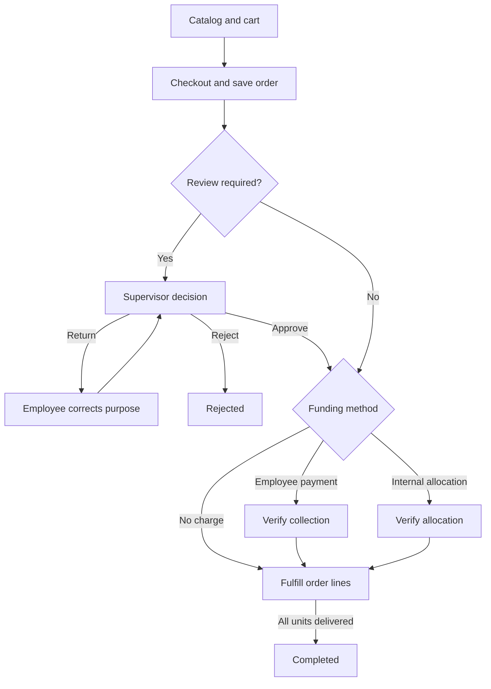

# FMS

FMS is a presentation prototype of the Financial Management System. Employees browse office products and services, place an order, and track it through approval, finance, and fulfillment. The six demo identities share one office’s fictional order history.

## Open the presentation

Open **presentation/FMS-Presentation.html** in a modern browser. This self-contained build includes the application, icons, illustration, and sample records. To recreate the file from a fresh checkout, run the installation and presentation commands below.

The dashboard opens as Alex Reyes. Use **Process guide** to explore the three funding paths, or **Demo workspaces** to change roles while following a single order. The current browser keeps cart and order edits. **Reset demo** restores the starting records. A repeatable clock begins on 24 November 2026 in Asia/Manila and advances with each recorded action.

## Run from source

Install Bun 1.3.14, then run these commands in the repository root. The development scripts invoke Nuxt with Bun. Use Node.js 24 LTS to run the optional Nitro server build.

```sh
bun install --frozen-lockfile
bun run dev
```

| Command | Result |
| --- | --- |
| `bun run presentation` | Generate the offline presentation in `presentation/` |
| `bun run generate` | Generate the static app and fixture JSON in `.output/public/` |
| `bun run build` | Build a Nitro application for `node .output/server/index.mjs` |
| `bun run typecheck` | Check application, server, and shared types |
| `bun test` | Exercise checkout and order policy scenarios |

## Present an order

| Item | Sample rate | Presentation path |
| --- | --- | --- |
| Office Supplies | ₱100.00 per kit | Employee checkout → supervisor approval → finance verifies the office allocation → fulfillment records issuance |
| Printing and Copying | ₱2.00 per page | Employee checkout → automatic acceptance → employee provides a sample receipt → finance verifies collection → print desk completes the handover |
| Document Processing | ₱50.00 per document | Automatic acceptance → verified employee payment → document release |
| Equipment Maintenance | ₱500.00 per job | Supervisor approval → verified office allocation → service completion |
| Equipment Consultation | No employee charge | Automatic acceptance → service fulfillment |
| Archive Retrieval | No employee charge | Unavailable example with zero capacity |

For a short walkthrough, place an **Office Supplies** order and note its order number. Switch to **Supervisor** to start and approve the review. In **Finance / Cashier**, verify an allocation with a sample reference. In **Fulfillment Staff**, start the line, mark it ready, and record the units handed over. Switch back to **Employee** and open **My orders** to see the completed order and its timeline.



## Configure the prototype

Set `NUXT_PUBLIC_APP_NAME` in `.env` to change the displayed name and browser title. The default is `FMS`. Restart the dev server or recreate the Compose app after changing it. For a standalone Nitro server, set the variable in the server process environment. For static hosting or the offline presentation, set it before running `bun run generate` or `bun run presentation`.

| Change | Source |
| --- | --- |
| Office, sample identities, currency display, timezone, policy label, role landing pages | `shared/config.ts` |
| Illustrative offerings, prices in integer centavos, options, capacity and funding | `shared/demo/catalog.ts` |
| Starting orders, activity and status examples | `shared/demo/seed.ts` |
| Cart checks, checkout snapshots, order decisions, finance and fulfillment gates | `shared/demo/cart.ts` and `shared/demo/workflow.ts` |
| Form fields, Zod rules and currency conversion | `shared/validation.ts` |
| Employee and staff navigation | `shared/navigation.ts` |
| Browser session, fixture loading and local edits | `app/plugins/demo.client.ts` and `app/composables/useFms.ts` |
| Screen layouts and Nuxt UI styling | `app/pages/`, `app/components/`, `app/app.config.ts`, `app/assets/css/` |
| PostgreSQL development schema and migration configuration | `server/db/schema.ts` and `drizzle.config.ts` |

Nuxt 4, Nuxt UI 4, TypeScript, and Tailwind CSS 4 power the interface. Nitro supplies `GET /api/demo.json` from the same fixtures embedded in the presentation. Zod validates checkout, corrections, references, and catalog edits. Use a single tab for a presentation. After changing seed data, rebuild the offline file and use **Reset demo** to load the new sample values.

## Development services

Docker can run the Nitro prototype with `docker compose up --build app`. PostgreSQL is a separate optional Compose profile. To check the Drizzle connection locally, copy `.env.example` to `.env`, run `docker compose --profile database up -d db`, then run `bun run db:check`. Use `bun run db:generate` to generate SQL migrations from the starter schema. The CI workflow checks types, runs the scenarios, and builds the offline artifact.

## Production boundary

The demo role picker, browser storage, and local audit events are presentation features. Before using real employee records, move state changes behind authenticated Nitro endpoints and enforce ownership, office scope, and assigned roles on the server. Use PostgreSQL transactions for order snapshots, idempotency, capacity reservations and the notification outbox. The starter schema covers the core records. Private uploads and scanning, timed reservation expiry and exceptions, immutable audit history, accounting adjustments, backups and deployment controls belong to the production implementation. The example rates, eligibility and timing can be revised when decisions D01–D08 are approved.
