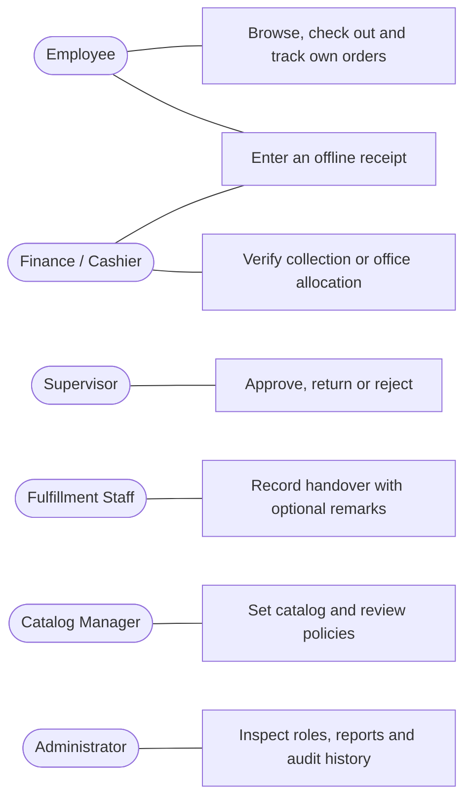
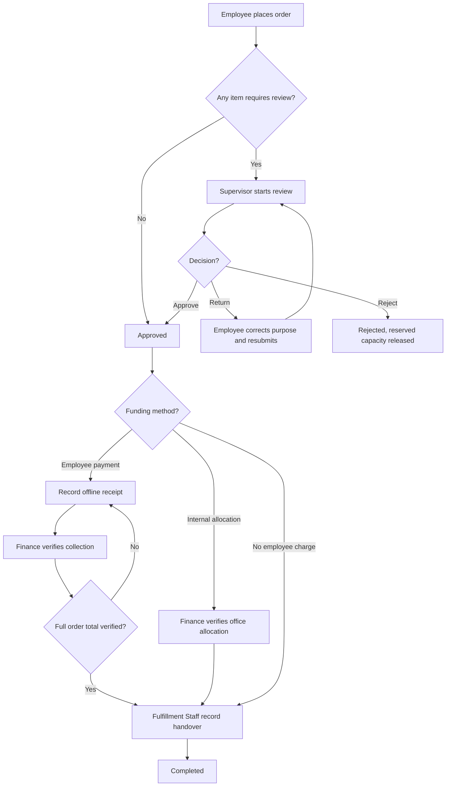
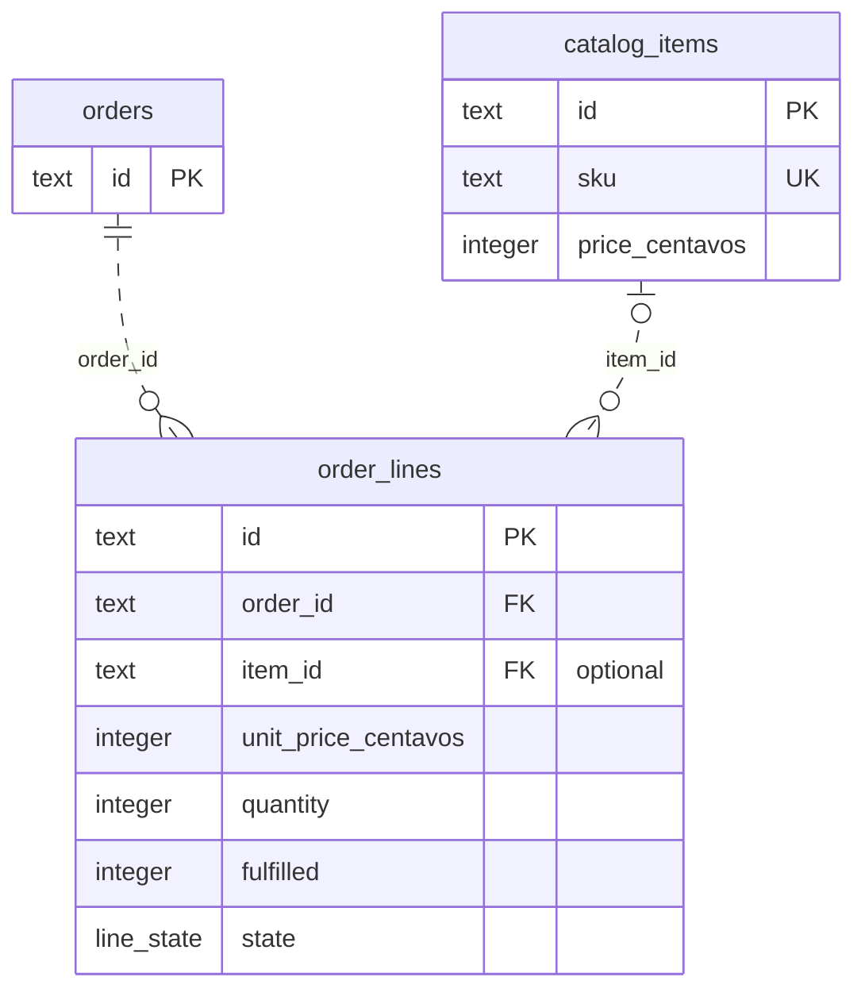
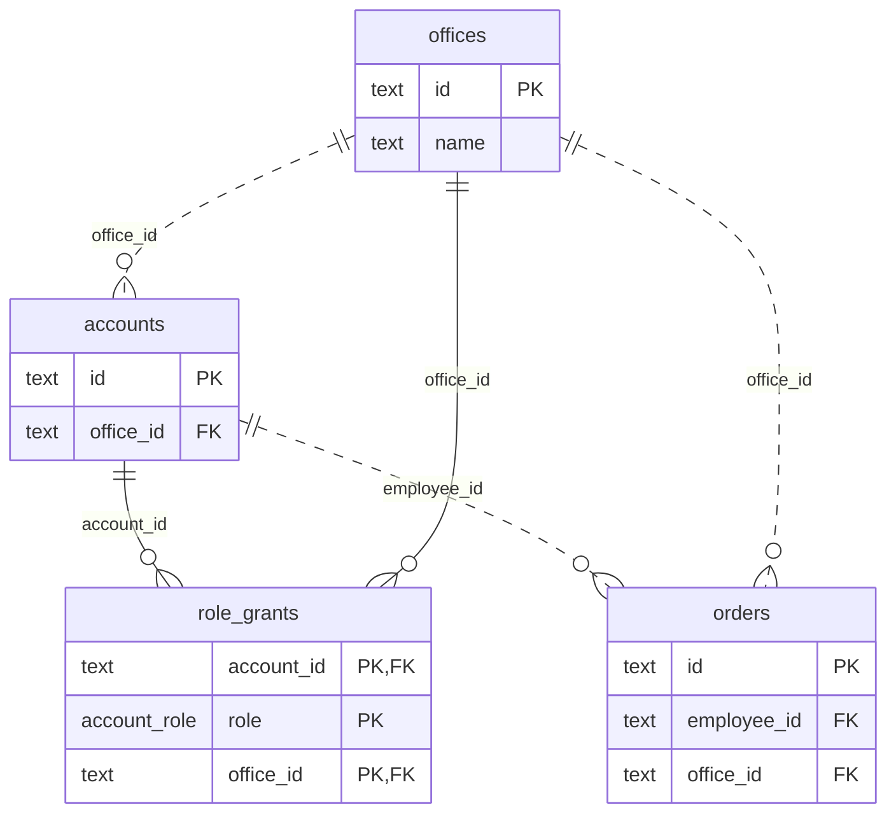
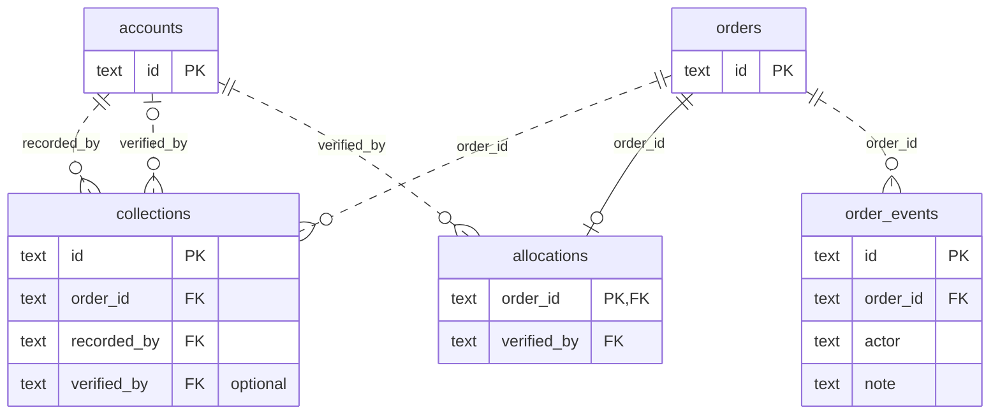

# FMS order fulfillment

This guide follows an employee order from catalog selection to delivery. Once the order has approval and funding clearance, Fulfillment Staff can add optional remarks and select **Record handover** once. The whole order becomes **Completed**.

The workflow describes the current browser-based prototype. The ERD describes the project’s PostgreSQL starter schema in `server/db/schema.ts`. Browser actions update the local demo session. The schema shows how those records relate in a database implementation.

## User diagram

Each line connects a role to an action it can perform. Employees work on their own orders. Staff actions follow the assigned office scope.

| Role | Primary action | Other details |
| --- | --- | --- |
| Employee | Choose items, check out and track own orders | Correct a returned request or submit a payment reference. |
| Supervisor | Review an office order | Approve it, return it with a reason, or reject it. |
| Finance / Cashier | Clear the funding requirement | Record or verify offline collections, or verify an office allocation. |
| Fulfillment Staff | Record handover for the whole order | Add optional remarks when delivering the goods or service. |
| Catalog Manager | Maintain products and services | Set price, capacity, funding and review requirements. |
| Administrator | Inspect activity and permissions | View office reports, role assignments and audit history. |

## Order flowchart

Each checkout must contain at least one eligible item and one funding method. The employee enters a business purpose and accepts the terms. Checkout saves each line’s price, quantity and selected option and reserves any tracked capacity.

A return keeps the order number. Rejection closes the order and releases its outstanding reservation. An employee can cancel an open order while there are no payment entries or allocation and all lines are still unstarted. Cancellation requires a reason and releases reserved capacity.

| Funding method | When handover becomes available |
| --- | --- |
| Employee payment | After Finance verifies receipt amounts totaling the entire order. A partial or unverified payment keeps the order on hold. |
| Internal allocation | After Finance records the verified office allocation reference for the approved order. The office covers the cost. |
| No employee charge | As soon as the order is approved or accepted by policy. |

### What Record handover changes

Staff may leave **Handover remarks** blank or enter up to 500 characters. One submission sets each remaining line’s delivered quantity to the ordered quantity, marks those lines **Fulfilled**, and marks the order **Completed**. The timeline records **Handover recorded** with the remarks and remaining units delivered, followed by **Order completed**. Previously issued units keep their history. Closed orders cannot be handed over again.

## Entity relationship diagrams

The nine tables appear in three views. Repeated tables refer to the same rows across views. The diagrams show the columns needed to trace each link. The data dictionary lists every column.

### Legend

| Symbol | Meaning | How to read it |
| --- | --- | --- |
| PK | Primary key | Identifies one row. In role_grants, the three PK columns identify one assignment together. |
| FK | Foreign key | Links a column to a key in another table. Follow its arrow to the referenced column. |
| UK / UK1 | Unique key | UK is unique on its own. Two columns marked UK1 in orders form one unique pair. |
| NULL | Value may be absent | Columns without NULL are required. Zero is a stored number, distinct from an absent value. |
| 1 / 0..1 | One / zero or one | The count at the parent end tells how many parent rows one child can reference. |
| 0..* / 1..* | Zero or more / one or more | The count at the child end tells how many child rows can belong to one parent. |

In these Mermaid views, a crow’s foot represents many, a circle represents zero and a bar represents one. A solid relationship means the foreign key forms part of the child’s primary key. A dotted relationship uses a foreign key outside the child’s primary key. The link label names the child column. The relationship tables give the same counts in numbers.

### Order contents

| Referencing column (FK) | Referenced column (PK) | Parents per child | Children per parent |
| --- | --- | --- | --- |
| `order_lines.order_id` | `orders.id` | `1` | `0..*` |
| `order_lines.item_id` | `catalog_items.id` | `0..1` | `0..*` |

One placed order contains one or more lines. The foreign key alone allows an order header to exist before any lines are inserted, hence the database count of `0..*`. A line always points to one order. Its catalog link can be empty because the line stores the original item name, code, unit, option, delivery instructions and price.

### People and office access

| Referencing column (FK) | Referenced column (PK) | Parents per child | Children per parent |
| --- | --- | --- | --- |
| `accounts.office_id` | `offices.id` | `1` | `0..*` |
| `role_grants.account_id` | `accounts.id` | `1` | `0..*` |
| `role_grants.office_id` | `offices.id` | `1` | `0..*` |
| `orders.employee_id` | `accounts.id` | `1` | `0..*` |
| `orders.office_id` | `offices.id` | `1` | `0..*` |

A person’s `accounts.office_id` identifies their home office. The `role_grants.office_id` value identifies the office where a role applies. The `orders.office_id` value identifies the requesting office for one transaction. A single account can place many orders and hold several office-specific roles.

### Finance and order history

| Referencing column (FK) | Referenced column (PK) | Parents per child | Children per parent |
| --- | --- | --- | --- |
| `collections.order_id` | `orders.id` | `1` | `0..*` |
| `collections.recorded_by` | `accounts.id` | `1` | `0..*` |
| `collections.verified_by` | `accounts.id` | `0..1` | `0..*` |
| `allocations.order_id` | `orders.id` | `1` | `0..1` |
| `allocations.verified_by` | `accounts.id` | `1` | `0..*` |
| `order_events.order_id` | `orders.id` | `1` | `0..*` |

An employee payment can have several receipts, each with a recorder and an optional verifier. Internal funding has at most one allocation because `allocations.order_id` is also its primary key. Each timeline event belongs to one order. The event actor is a saved display label, with no foreign key to accounts.

## Column dictionary

Names match PostgreSQL exactly. A dash in the keys column means a required field with no key property. Columns marked NULL are optional. Integer amounts use centavos, with 100 centavos to one Philippine peso. `timestamptz` means timestamp with time zone. Types ending in `_mode`, `_role` or `_state` use a fixed list of allowed values.

### Offices (`offices`)

One row identifies an office used for membership, permissions or order ownership.

| SQL column | Type | Keys / optionality | Meaning or relationship |
| --- | --- | --- | --- |
| `id` | `text` | PK | Stable office identifier used by the other tables. |
| `name` | `text` | — | Office display name, such as Administrative Services. |

### Accounts (`accounts`)

One row identifies a person and their home office.

| SQL column | Type | Keys / optionality | Meaning or relationship |
| --- | --- | --- | --- |
| `id` | `text` | PK | Stable account identifier, such as EMP-0142. |
| `name` | `text` | — | Person’s display name. |
| `office_id` | `text` | FK | Home office. References offices.id. |

### Office role assignments (`role_grants`)

The three columns together form the primary key. An account can hold different roles or act in different offices.

| SQL column | Type | Keys / optionality | Meaning or relationship |
| --- | --- | --- | --- |
| `account_id` | `text` | PK, FK | Person receiving the role. References accounts.id. |
| `role` | `account_role` | PK | Assigned role, such as supervisor or fulfillment. |
| `office_id` | `text` | PK, FK | Office where the role applies. References offices.id. |

### Catalog items (`catalog_items`)

One row describes a product or service available to configure in the catalog.

| SQL column | Type | Keys / optionality | Meaning or relationship |
| --- | --- | --- | --- |
| `id` | `text` | PK | Stable item identifier, such as office-supplies. |
| `sku` | `text` | UK | Unique item code shown to staff, such as SUP-001. |
| `title` | `text` | — | Item name shown in the catalog. |
| `unit` | `text` | — | Unit used for orders, such as kit or page. |
| `price_centavos` | `integer` | — | Current price per unit in centavos. Minimum 0. |
| `funding` | `funding_mode` | — | Who covers the charge. Copied to the order at checkout. |
| `review` | `boolean` | — | True when this item requires supervisor review of the whole order. |
| `capacity` | `integer` | NULL | Units available. Zero means none available. NULL means untracked capacity. |
| `active` | `boolean` | — | Publication flag. Defaults to true. |
| `version` | `integer` | — | Catalog record version. Defaults to 1. |

### Order header (`orders`)

One row represents one checkout, regardless of the number of products or services ordered.

| SQL column | Type | Keys / optionality | Meaning or relationship |
| --- | --- | --- | --- |
| `id` | `text` | PK | Order number shared across the process, such as FMS-2026-0100. |
| `employee_id` | `text` | FK, UK1 | Requester. References accounts.id. |
| `office_id` | `text` | FK | Requesting office. References offices.id. |
| `placed_at` | `timestamptz` | — | Date and time the employee placed the order. |
| `checkout_key` | `text` | UK1 | Identifies a checkout attempt. Unique together with employee_id. |
| `policy_version` | `text` | — | Version of the ordering policy accepted at checkout. |
| `funding` | `funding_mode` | — | Single funding method used by the whole order. |
| `currency` | `text` | — | Currency code for the order. Defaults to PHP. |
| `status` | `order_state` | — | Overall stage, such as Submitted, Approved or Completed. |
| `approval` | `approval_state` | — | Supervisor decision or review state, including Not required. |
| `purpose` | `text` | — | Employee’s business reason. Can be corrected on a returned order. |
| `version` | `integer` | — | Order record version. Defaults to 1. |

### Items on an order (`order_lines`)

One row records an ordered item and option. The copied details preserve what the employee requested and the agreed price.

| SQL column | Type | Keys / optionality | Meaning or relationship |
| --- | --- | --- | --- |
| `id` | `text` | PK | Unique identifier for this order line. |
| `order_id` | `text` | FK | Order that contains the line. References orders.id. |
| `item_id` | `text` | FK, NULL | Original catalog item, if linked. References catalog_items.id. |
| `title` | `text` | — | Item name at checkout. |
| `sku` | `text` | — | Item code at checkout. The same code can occur on many orders. |
| `unit` | `text` | — | Unit at checkout, such as kit, page or job. |
| `option` | `text` | — | Selected variant at checkout, such as Standard kit or A4. |
| `delivery` | `text` | — | Pickup or service instructions at checkout. |
| `unit_price_centavos` | `integer` | — | Agreed unit price in centavos. Minimum 0. |
| `quantity` | `integer` | — | Units ordered. Must be greater than 0. |
| `fulfilled` | `integer` | — | Units delivered. Defaults to 0 and must stay between 0 and quantity. |
| `state` | `line_state` | — | Line’s fulfillment state. A completed handover sets this to Fulfilled. |

### Employee payments (`collections`)

Each row records one offline collection or receipt reference against an employee-funded order.

| SQL column | Type | Keys / optionality | Meaning or relationship |
| --- | --- | --- | --- |
| `id` | `text` | PK | Unique identifier for the collection. |
| `order_id` | `text` | FK | Order being paid. References orders.id. |
| `reference` | `text` | UK | Unique receipt or collection reference. |
| `amount_centavos` | `integer` | — | Amount covered by this receipt, in centavos. Must be positive. |
| `recorded_by` | `text` | FK | Account that entered the receipt. References accounts.id. |
| `verified_by` | `text` | FK, NULL | Finance verifier. References accounts.id. NULL while awaiting verification. |
| `recorded_at` | `timestamptz` | — | When the receipt was entered. |

### Office allocations (`allocations`)

An internally funded order can have one verified office allocation.

| SQL column | Type | Keys / optionality | Meaning or relationship |
| --- | --- | --- | --- |
| `order_id` | `text` | PK, FK | Identifies the allocation and its order. References orders.id. |
| `reference` | `text` | — | Office authorization reference supplied by Finance. |
| `amount_centavos` | `integer` | — | Value covered by the office allocation, in centavos. Must be positive. |
| `verified_by` | `text` | FK | Finance account that authorized it. References accounts.id. |

### Order timeline (`order_events`)

Each row records an action on an order, including the actor, time and explanatory note.

| SQL column | Type | Keys / optionality | Meaning or relationship |
| --- | --- | --- | --- |
| `id` | `text` | PK | Unique timeline event identifier. |
| `order_id` | `text` | FK | Order this event belongs to. References orders.id. |
| `actor` | `text` | — | Display label of the person or system that recorded the event. |
| `title` | `text` | — | Event name, such as Handover recorded or Order completed. |
| `note` | `text` | — | Event details. For a handover, includes any remarks and the units delivered. |
| `visible_to_employee` | `boolean` | — | Whether the event is intended for the employee to see. |
| `at` | `timestamptz` | — | When the event occurred. |

### Allowed values

| PostgreSQL type | Stored values |
| --- | --- |
| `account_role` | employee, supervisor, finance, fulfillment, catalog, admin |
| `funding_mode` | employee, internal, free |
| `order_state` | Submitted, Under review, Returned, Approved, In progress, Completed, Rejected, Cancelled |
| `approval_state` | Not required, Pending, Under review, Returned, Approved, Rejected |
| `line_state` | Not started, In progress, Ready, Fulfilled, Cancelled |

The direct handover accepts approved orders and existing orders in progress once funding is clear. New orders can go directly from Approved to Completed and from Not started to Fulfilled on their lines.

## Follow one order through the data

An employee orders two Office Supplies kits at PHP 100 each. The order uses internal funding and requires supervisor review. After Finance verifies the PHP 200 office allocation, Fulfillment Staff can deliver both kits and record one handover.

| Step | Example values | What connects them |
| --- | --- | --- |
| Checkout | `orders.id = FMS-2026-0100`, `catalog_items.id = office-supplies` | `order_lines.order_id` holds the order ID. `order_lines.item_id` holds the catalog ID. |
| Price | `quantity = 2`, `unit_price_centavos = 10000` | Use order-line prices. The order total is 20,000 centavos or PHP 200.00. |
| Allocation | `allocations.order_id = FMS-2026-0100`, `amount_centavos = 20000` | In the schema this row links the authorization to the order. The demo stores the reference and verifier on the order. |
| Handover | Optional remark “Collected at General Services.” | The line ends with `fulfilled = 2` and `state = Fulfilled`. The order ends with `status = Completed`. The handover event records the note against the same order ID. |

## Implementation references

- [server/db/schema.ts](../server/db/schema.ts) — Table names, SQL columns, constraints and foreign keys.

- [shared/demo/cart.ts](../shared/demo/cart.ts) — Cart validation, checkout, capacity reservation and line snapshots.

- [shared/demo/workflow.ts](../shared/demo/workflow.ts) — Review, corrections, finance checks and final handover.

- [shared/orders.ts](../shared/orders.ts) — Funding clearance, office scope and permitted order states.

- [app/components/OrderActions.vue](../app/components/OrderActions.vue) — Role actions, optional remarks and the handover button.

- [shared/validation.ts](../shared/validation.ts) — Form rules, including the 500-character handover remarks limit.

- [app/plugins/demo.client.ts](../app/plugins/demo.client.ts) — Browser session storage used by the prototype.
